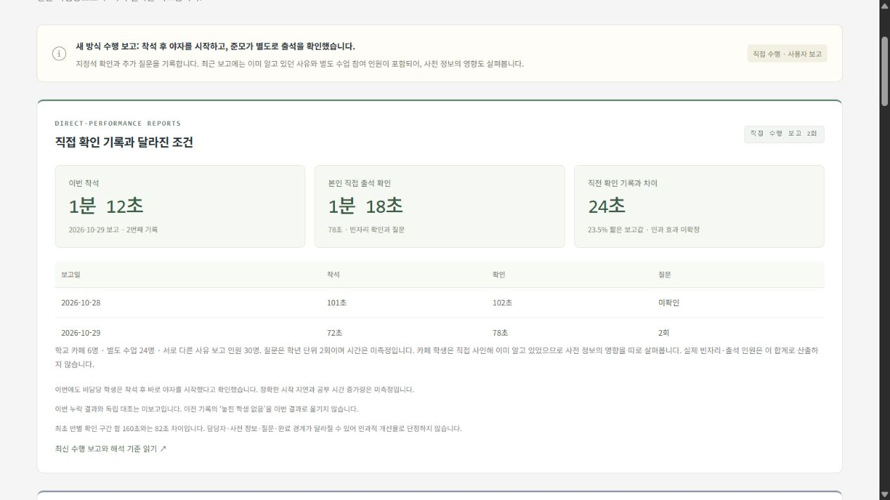

# FlowBench

**What should have to finish before students can start studying?**

[](https://github.com/J0hns0n-K/FlowBench/actions/workflows/verify.yml)

FlowBench is a browser-native TypeScript workbench for investigating seated attendance verification. It connects a real operational problem with explicit process models, reproducible experiments and field reports. Its central question is whether attendance verification needs to block the start of study—and what happens to the people doing the checking when that dependency changes.

## The problem changed before the solution did

The initial proposal assumed an entrance check-in queue. Follow-up accounts established that students entered freely, sat in assigned seats, and were checked one class at a time. There was no entrance queue to optimize. The investigation shifted to the sequence of seating, verification, reporting and study start.

The student committee collectively decided to start study after seating and verify attendance separately. Junmo proposed trying vacant-seat exception checks in the current workflow, then personally performed trials, asking friends and same-grade students about late or out students. FlowBench now examines two distinct questions: **how soon non-checkers can begin studying**, and **how much time, follow-up and interruption verification still requires**.

This progression—from correcting the premise to changing the dependency—is documented in the [decision register](docs/DECISIONS.md), rather than reconstructed from a favorable result.

## Current evidence

<!-- FLOWBENCH:CURRENT:START -->
<!-- Evidence fingerprint: 466bf8c93231a2ede3ee6b2b3210c5c181481f96c23ec19f8456dfb3cb12e3b6 -->
This series contains reports with both seating and checking durations, through the linked report received **2026-10-29**: **2** reports. Separate enquiry/checking-only observations are described below. Report dates are not independently confirmed observation dates.

| Report | Seating | Attendance verification | Source |
| --- | --- | --- | --- |
| Earlier class-by-class procedure · received 2026-10-27 | 103 s | 160 s, summed across 8 class turns | [Peer timing relayed by Junmo](data/peer-timed-baseline-2026-10-27.json) |
| Committee-check report 1 · received 2026-10-28 | 101 s | 102 s | [Direct performance reported by Junmo](data/committee-observation-2026-10-28.json) |
| Committee-check report 2 · received 2026-10-29 | 72 s | 78 s | [Direct performance reported by Junmo](data/committee-observation-2026-10-29.json) |

The latest checking duration in this seating/checking series is **82 s (51.25%) shorter** than the earlier combined-turn sum. Relative to the preceding direct-performance report, checking was 24 s (23.53%) shorter. These are descriptive comparisons of different sessions and methods. Timer metadata and completion boundaries remain incompletely documented; they are not causal estimates or average improvements.

Latest context: 6 students at the school cafe and 24 in a separate class, 30 distinct students by explicit confirmation; 2 grade-level enquiry events. These counts are not a measured vacant-seat count or verified attendance denominator. Cafe attendance was already known through Junmo's prior authorization; Information availability is a possible confounding factor, not a demonstrated cause of the timing difference.

Non-checkers reportedly began study after seating. Exact study-start latency and the checker's study start remain unknown. No missed-student result was supplied for the latest session. An independently audited error rate has not been established. [Full report](docs/SECOND_COMMITTEE_OBSERVATION_KO.md).
<!-- FLOWBENCH:CURRENT:END -->

The second report introduces a new experimental variable: **what the checker already knows**. Junmo already knew the cafe participants because he had authorized them; two grade-level enquiries addressed the separate class. The investigation now distinguishes seat occupancy, known reasons and unresolved exceptions. Whether prior information reduces checking work—and what it costs to obtain, share and maintain that information—needs comparison across sessions and rotating checkers. [Read the latest field report](docs/SECOND_COMMITTEE_OBSERVATION_KO.md).

A later, explicitly **different session** supplied enquiry intervals of 14 s and 13 s, followed by a whole checking duration of **103 s** and confirmation that Junmo did no other work while waiting for answers. If the reported enquiry intervals lie within that total without overlap, **27 s (26.21%)** belongs to those intervals and **76 s** remains outside them. The residual is not a separate measurement of scanning or recording, and reducing enquiries has not been shown to recover all 27 s. This [linked checking/enquiry record](docs/INQUIRY_TIMING_01_KO.md) has no seating duration; it remains separate from the two reports containing both seating and checking. The earlier 78 s belongs to another session.

A stage-by-stage report received **2026-10-30**, explicitly confirmed as a **new, separate session**, adds countdown 10 s, seating/settling 31 s, scanning 58 s, enquiries 17 s and 23 s, and rechecking 25 s. If these durations form consecutive, complete intervals, they sum to **164 s**, including **123 s of checking** and **40 s of enquiries**. The earlier 103 s report remains unchanged. The stage sums are kept distinct from directly reported totals. These two enquiry-timed sessions each contain two questions, yet their enquiry totals differ (27 s versus 40 s); question count alone does not specify duration. The [stage report](docs/STAGE_TIMING_01_KO.md) makes rechecking an explicit task for further process analysis.

Junmo clarified that the 25 s recheck was a rough browse of what he called a dormitory layout chart, intended to look for students sitting elsewhere. Whether any seat changes were found or attendance decisions corrected was not reported; the chart's relationship to chapel seating remains unspecified. This adds a concrete failure mode to investigate: seat occupancy and student presence can differ. The next observation will record aggregate recheck outcomes alongside duration; the informal browse is not an independent accuracy audit.

The [next stage report, received **2026-10-31**](docs/STAGE_TIMING_02_KO.md), contains countdown 10 s, seating/settling 50 s, scanning 46 s, one enquiry of 11 s and rechecking 21 s. Conditional sums are **60 s preparation, 78 s checking and 138 s overall**. Checking is 45 s shorter than the preceding stage sum, while preparation is 19 s longer; scanning and rechecking also changed. Junmo reports **zero suspected seat-change cases**, which is not an audited zero-error result. There are now **five committee-check observation sessions**: two directly reported seating/checking totals, one checking/enquiry record and two stage reports, excluding the earlier peer baseline. The next design task is to specify what evidence can move an ambiguous vacant-seat case into a confirmed status; more timing reports alone will not define that behavior.

Junmo's [submitted enquiry procedure](docs/ESCALATION_PROCEDURE_KO.md) specifies an ordered contact chain: classmates or close friends, a leader or grade-12 student, the dormitory supervisor, then a phone call to the principal. He subsequently supplied the first-contact stopping rule: hear the student's specific destination from a peer, then make no further checks. This is a concrete student-supplied design criterion. It closes the enquiry **on a peer report**; it does not independently verify location or authorization. Later-stage criteria, conflicting-answer handling and the final unresolved outcome remain unspecified; no full-chain execution or official policy is inferred. Assisted synthetic test cases now distinguish a specific answer, an insufficient answer and a specific but incorrect answer. Student review of that last failure case precedes implementation; these are proposed tests, not new field results or implemented features.



## Engineering that makes the investigation inspectable

The workbench separates three kinds of reasoning:

| Component | Engineering purpose | Inspect it |
| --- | --- | --- |
| Deterministic FCFS and count/report workflows | Compare identical synthetic workloads with explicit task ordering, server ties and reporting bottlenecks. | [Engine](src/engine.ts) · [workflow model](docs/MODEL.md) |
| Dependency graph with unknown durations | Compute earliest milestones in O(V+E). Unknown checking time propagates only through dependent paths; it never becomes zero. Role views keep the checker distinct from non-checkers. | [DAG scheduler](src/dependencies.ts) · [dependency contract](docs/DEPENDENCY_MODEL.md) |
| Field-report accounting | Validate provenance and intervals, preserve missing metadata, and calculate descriptive differences separately from simulated predictions. | [Accounting code](src/observed.ts) · [source records](data/) |

Pure functions are shared by the browser, tests and experiment runner. Verification covers hand-calculated fixtures, simultaneous events, conservation, invalid inputs, reproducible seeds, unknown propagation and adverse outcomes. JSON/CSV serializers retain synthetic inputs, raw events, assumptions and source versions; charts visualize the same calculations.

The [locked synthetic study](docs/EVALUATION.md) includes a favorable 268 s versus 78 s fixture **and** a reporting-dominated counterexample with only a 1.37% difference. Longer reporting times also reject the waiting-time hypothesis. These results expose the model's limits; they are separate from school observations.

## A focused contribution

Browser simulation and queueing algorithms have established [prior work](docs/RELATED_WORK.md). FlowBench's project-specific investigation concerns the fit between an actual seated workflow, its dependencies and the evidence needed to evaluate a change. It keeps rejected premises, failed hypotheses and unresolved quantities visible alongside working software.

A graduate's recollection, relayed by Junmo, also identifies earlier local use of what was described as the same checking approach. The graduate recalled roughly 2–3 minutes **including seating**, with about 70–80 students; no recorded average or detailed protocol was supplied. This [local precedent](docs/LOCAL_PRECEDENT_KO.md) places the investigation in a history of practice. Junmo's contribution concerns current application, explicit modeling and validation; origination of the checking method is not established. The recalled whole-process range is kept separate from current verification-only timings.

The current prototype runs locally in the browser using anonymous group workloads and aggregate timing reports. Its analytical records exclude names, seat maps and individual attendance histories. This keeps the engineering question focused on process structure, verification effort and the quality of the evidence.

## People and responsibility

Junmo's reported contributions include explaining and correcting the real workflow, proposing its current trial, personally performing checks, supplying observations and seeking prior users' experience. The procedure decision belongs to the committee collectively; a peer supplied the earlier timing series, and a graduate's recalled prior use is credited separately.

In a guided modeling exercise, Junmo supplied synthetic 120 s and 135 s cases and noticed that the more-question case would need quicker responses to finish sooner when scanning and recording costs stayed fixed. The [submitted reasoning and follow-up](docs/STUDENT_REASONING_01_KO.md) distinguish his calculations and observation from the assisted formal clarification and test implementation. This advances the model review from question count alone toward total enquiry duration.

The initial model formalization, code, tests and documentation were produced with Codex assistance. Individually authored model revisions and software changes will be linked as they occur. The [contribution ledger](docs/CONTRIBUTIONS.md) distinguishes field execution, measurement, design and implementation, with dated evidence for each.

## Reproduce and follow the work

Requires Node.js 24+ and pnpm 11.25.0.

```sh
pnpm install --frozen-lockfile
pnpm test
pnpm build
pnpm dev
```

Open http://127.0.0.1:4173/. `pnpm experiment` reproduces the synthetic study. GitHub Actions runs the tests, typechecked build, experiment and overview freshness check. Browser export serializers are tested; actual browser download completion remains an open check in [issue #4](https://github.com/J0hns0n-K/FlowBench/issues/4). The workbench is a local prototype.

Explore the [research and development records](docs/INDEX.md), [validation protocol](docs/VALIDATION.md) and [open work](docs/ISSUES.md). The overview is maintained with the evidence using the [update protocol](docs/OVERVIEW_MAINTENANCE.md).
