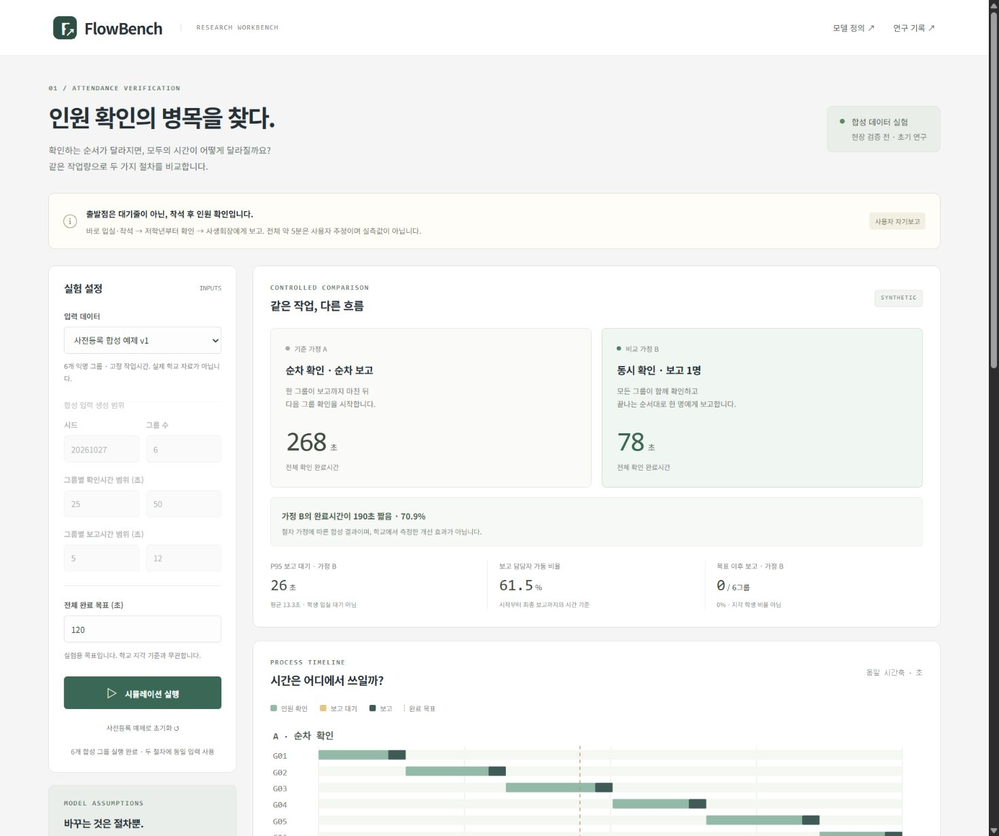

# FlowBench

Browser-native TypeScript research workbench for **seated attendance verification workflows**.

**Kickoff: 2026-10-27, Asia/Seoul.** Research validity comes before feature count.

## What changed at kickoff

The initial handoff proposed a check-in queue simulator. Follow-up descriptions establish a different workflow: participants enter without an entrance queue, sit/settle, and class representatives check attendance in lower-grade-first order and report to a student coordinator. The latest user report gives **entry-to-seated about 60 s and verification about 120 s**; any extra settling gap and deadline-relative offsets are unknown. A roughly ten-second countdown precedes a minute-25 deadline. These are approximate user reports without raw timing records, refining earlier coarse estimates. There is no individual check-in device. Consequently, “reducing an existing check-in queue” is not an evidence-supported project claim.

The working research question is now: **Under explicitly stated counting and reporting assumptions, how does the organization of attendance verification affect total completion time and the coordinator's reporting bottleneck?** Whether changing the real process is useful remains an empirical question.

## Evidence and scope

- Simulations use anonymous, **synthetic group tasks**, not student records.
- The user subsequently clarified that verification is performed **one class at a time**. Serial class ordering is now user-reported context; exact handoff gaps, durations and field validation remain unknown. Parallel verification is a proposed alternative.
- No measured speedup, error reduction, deployment, or independent student implementation is established.
- The initial code and documentation are authored with Codex assistance. See [contributions](docs/CONTRIBUTIONS.md).
- Early: browser-local TypeScript, no server, login, biometrics, IoT, hardware, or school system integration.
- DormSense and RoboMetrics remain separate, unimplemented RD research candidates.

## Project records

한국어 요약과 다음 학생 작업: [첫 세션 기록](docs/KICKOFF_KO.md).

| Record | Purpose |
| --- | --- |
| [Problem and evidence](docs/PROBLEM_VALIDATION.md) | Current procedure, corrected premise, unknowns |
| [Model contract](docs/MODEL.md) | Equations, event ordering, metric definitions |
| [Decisions](docs/DECISIONS.md) | Versioned research questions, hypotheses and decisions |
| [Related work](docs/RELATED_WORK.md) | Primary-source competitor and research audit |
| [Validation protocol](docs/VALIDATION.md) | Numerical verification versus field validation |
| [Observation sheet](docs/OBSERVATION_SHEET_KO.md) | Blank anonymous timing record and model-gap check |
| [Session phase boundaries](docs/SESSION_PHASES_KO.md) | Preparation versus verification; current engine covers verification only |
| [Image-derived group sizes](docs/GROUP_COUNTS_KO.md) | Provisional aggregate counts only; no names or scores |
| [Experiment log](docs/EXPERIMENT_LOG.md) | Dated commands and observed results |
| [Claim ledger](docs/CLAIM_LEDGER.md) | Permitted and unsupported claims |
| [Admissions evidence](docs/ADMISSIONS_EVIDENCE.md) | Prior activities, source status and attribution limits |
| [Student workbook](docs/STUDENT_WORKBOOK.md) | Student decisions, derivations and observations still needed |
| [Sources](docs/SOURCES.md) | Source scope and retrieval limitations |
| [Repository](docs/REPOSITORY.md) | Verified remote, owner, branch and initial SHA |
| [Issues](docs/ISSUES.md) | Research and implementation work units |

## Run the local workbench

Requires Node.js >=24 and pnpm 11.25.0 (`npm install --global pnpm@11.25.0` if needed).

```sh
pnpm install --frozen-lockfile
pnpm test
pnpm build
pnpm dev
```

Open http://127.0.0.1:4173/. To rerun the preregistered synthetic study, use `pnpm experiment`. It records the current source revision and overwrites the dated synthetic report with the new run; use Git to preserve earlier reports.

If dependencies and `dist/` are already present, `node scripts/serve.mjs` starts the preview directly. Rebuild after source changes. The app runs locally with no external API, font or analytics dependency. No hosted deployment is claimed.

## Implemented and verified

- Pure deterministic FCFS engine plus explicit serial/parallel count-report workflows.
- 22 passing numerical/invariant/export tests, with separate TypeScript checks.
- Same-input comparisons, per-group timeline, P95 reporting wait and target-crossing metrics.
- Seeded and editable synthetic inputs; JSON/CSV serializers include provenance, assumptions, raw events and model/source versions.
- Browser checks of exact outputs, invalid ranges, reset, custom edits, 100 groups and a narrow mobile viewport.
- [Synthetic study](docs/EVALUATION.md), [machine-readable report](experiments/2026-10-27-synthetic-v1.json), and [browser QA](docs/BROWSER_QA.md).
- GitHub Actions repeats unit tests, typechecked build and the synthetic experiment.

Actual browser file-download verification was blocked by the browser permission review; serializer tests passed. This limitation remains tracked in issue #4.



This repository is an assisted research starting point, not proof of a completed student EC. Original-source audit, student-authored contribution and field validation remain open.
