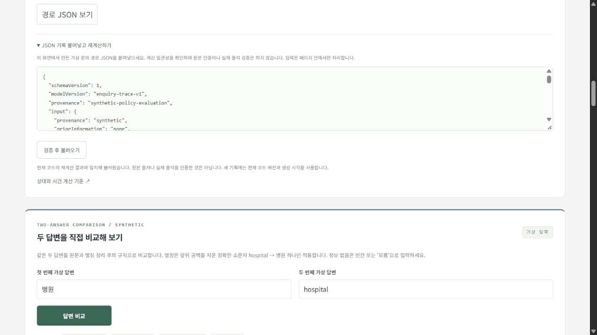
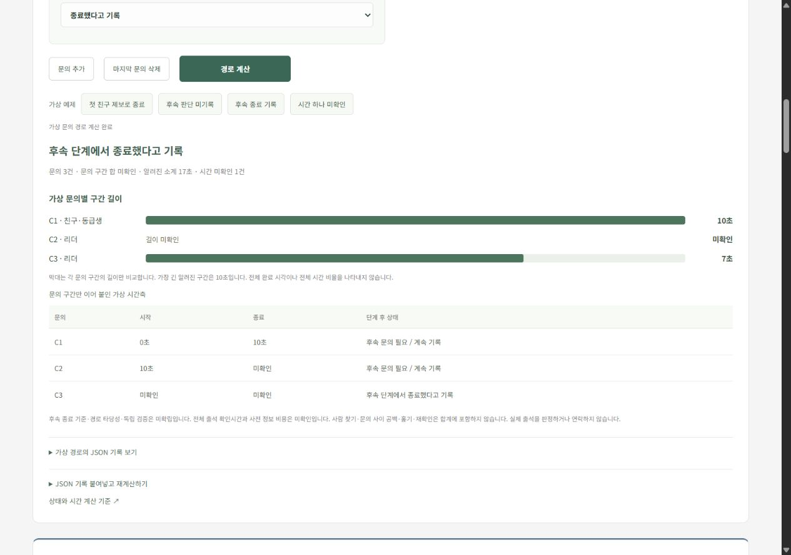
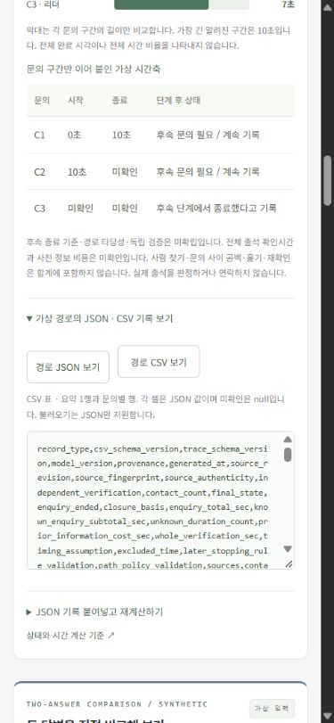

# 문의 경로를 재현하는 단계별 코어

2026-11-18 (Asia/Seoul). [작업 #14](https://github.com/J0hns0n-K/FlowBench/issues/14).

## 구현할 수 있는 규칙과 남겨 둔 미확인

[학생이 검토한 절차](../data/student-workflow-confirmation-2026-11-04.json)는 직접 허가해 행선지를 이미 알면 질문을 건너뛰고, 모르면 친구에게 묻고, 구체적 행선지를 듣고 잘 모르는 상태가 아니면 문의를 끝내며, 잘 모르면 사감쌤이나 리더에게 다시 묻는 것입니다. [첫 문의 코어](../src/inquiry-policy.ts)는 이 첫 분기만 판정합니다.

두 번째 이후 답변에서의 종료 기준과 실제 문의 대상의 우선순위는 아직 확인되지 않았습니다. [단계별 코어](../src/enquiry-trace.ts)는 **입력한 경로를 재현**하며 후속 기준을 새로 만들지 않습니다. 리더→사감쌤→교장쌤이라는 필수 일정이나 경로를 자동 생성·승인하지 않습니다. 학교 공식 규칙이나 실제 출석 판정으로 채택된 기능도 아닙니다.

## 입력 계약

모든 입력은 provenance가 synthetic인 가상 시나리오여야 합니다. priorInformation은 none 또는 checker-prior-authorization이고, 직접 허가한 사전 정보 경로에는 문의를 붙이지 않습니다. 사전 정보를 얻고 전달하는 시간은 별도로 미확인입니다.

각 contacts 항목은 다음을 명시합니다.

| 필드 | 의미 |
| --- | --- |
| id | 중복 없는 익명 코드. 실제 학생 이름을 받는 필드가 아님 |
| target | peer, leader, dormitory-supervisor, principal 중 기록한 문의 대상 |
| specificDestinationReported | 구체적인 행선지가 전달됐는지 나타내는 명시적 가상 입력 |
| uncertaintyReported | 잘 모르는 상태가 표시됐는지 나타내는 명시적 가상 입력 |
| enquiryDurationSec | 0~86,400초 또는 명시적인 null. 누락된 값을 0으로 채우지 않음 |
| followUpDisposition | 첫 문의에서는 null. 두 번째부터 continue, reported-stop, not-recorded 중 하나 |

사전 정보가 없는 경우 첫 항목은 peer이며 기존 evaluatePeerEnquiry를 그대로 호출합니다. 두 번째부터는 입력한 대상 순서를 보존하고 종료 판단 기록을 따릅니다. 이후 다시 peer가 나오는 기록도 후속 단계로 다루며 첫 문의 규칙을 다시 적용하지 않습니다. target은 기록용 역할 범주이며 경로의 타당성을 승인하는 값이 아닙니다.

계산 범위는 최대 32개 문의 구간입니다. 이는 프로그램의 유한 입력 한계이며 실제 허용 질문 횟수나 학교 규정이 아닙니다. 종료 기록 뒤에 문의를 더 붙이거나, 종료 판단이 미기록인 단계 뒤에 문의를 붙이면 불완전한 실행 기록으로 거부합니다. 후속 기록을 재현하려면 그 단계의 판단을 명시해야 한다는 형식 제약입니다.

## 상태와 근거를 구별하기

| finalState | enquiryEnded | 의미 |
| --- | --- | --- |
| not-started | false | 사전 정보가 없고 문의 기록도 아직 없음 |
| skipped-on-prior-information | true | 입력한 직접 허가 정보로 질문을 건너뜀 |
| closed-on-peer-report | true | 확인된 첫 문의 규칙에 따라 친구 제보로 종료 |
| follow-up-required | false | 첫 분기에서 후속 문의가 필요하거나 후속 단계에서 계속한다고 기록 |
| reported-stop-after-follow-up | true | 가상 입력에 종료했다고 명시됨. 종료 기준의 타당성은 미확립 |
| follow-up-disposition-unknown | null | 후속 단계 종료 판단이 미기록. 답변이 구체적이어도 자동 종료하지 않음 |

closureBasis는 직접 허가 정보, 첫 문의 규칙, 후속 단계의 종료 기록 중 어느 근거에서 종료 표시가 생겼는지 구별합니다. reported-stop은 답변이 불확실한 상태에도 입력될 수 있습니다. 코어는 이를 검증된 종료로 바꾸지 않고 입력한 종료 기록과 불확실성 표시를 함께 보존합니다. 후속 종료 기준과 경로 타당성, 독립 검증은 모두 not-established입니다.

따라서 enquiryEnded는 문의 흐름에 대한 모델 결과 또는 입력된 종료 기록입니다. 사실 확인 완료·허가 확인·실제 위치·출석 여부를 뜻하지 않습니다. 문자열의 same/conflict 결과도 이 코어에 자동 전달하지 않습니다.

## 시간 계산

가정은 **입력한 문의 구간이 겹치지 않고 차례로 이어지는 합성 시간축**입니다. startOffsetSec/endOffsetSec는 이 문의 구간들만 누적한 오프셋으로 실제 시계 시각이 아닙니다. 찾으러 다니기, 구간 사이의 공백, 사전 정보 확보·전달, 지정석 훑기, 다시 확인하기를 포함하지 않습니다.

시간 하나가 null이면 그 구간의 종료와 이후 구간의 시작·종료 오프셋, enquiryTotalSec는 null입니다. 이후 알려진 구간도 knownEnquirySubtotalSec에는 포함하되 전체 시간으로 바꾸지 않습니다. unknownDurationCount는 모르는 문의 구간 수입니다. 질문을 하지 않은 경우 문의시간 합은 0이지만 priorInformationCostSec와 wholeVerificationSec는 여전히 null입니다.

문의 n개를 한 번 순회하므로 계산·보관 공간은 O(n)입니다. 입력과 사건의 스냅샷을 따로 만들고 JSON 왕복 후 같은 입력으로 결과를 재현할 수 있습니다. 반환 형식은 schema 1 / enquiry-trace-v1입니다. 이 순수 계산 코어는 빌드 SHA·생성 시각을 붙이는 별도 내보내기 기능이나 화면에 아직 연결되지 않았습니다.

## 검증

[테스트 7개](../tests/enquiry-trace.test.ts)는 다음을 확인합니다. 아래 시간은 보조자가 만든 **가상 테스트 숫자**이며 기존 현장 질문시간을 문의 대상별로 재배정한 값이 아닙니다.

| 가상 기록 | 결과 |
| --- | --- |
| 친구가 구체적 행선지를 전달, 불확실성 없음, 10초 | 첫 문의 종료·합 10초. 뒤에 문의 추가 시 거부 |
| 친구 문의 10초 후 리더 답변 20초가 구체적이나 종료 판단 미기록 | 합 30초여도 종료 여부는 null |
| 친구→사감쌤→리더→교장쌤, 가상 시간 10+20+5+15초, 마지막에 종료했다고 입력 | 합 50초·reported-stop. 종료 기준·경로·독립 검증은 미확립 |
| 10초→null→7초→0초 | 전체 문의시간 null, 알려진 소계 17초, 미확인 구간 1개 |
| 사전 정보로 질문 생략 | 문의 0건·0초, 정보 비용과 전체 확인시간은 null |

일곱 검증 항목은 첫 분기·후속 미기록·기록된 경로/종료·미확인 시간·사전 정보·스냅샷/JSON 재실행·잘못된 입력/계산 한계입니다. 전체 **76개 테스트와 형식 검사·빌드가 통과**했습니다. 기존 표현 한계 반례의 CI 재현도 유지합니다. 화면 동작을 변경하지 않아 브라우저 검증을 다시 하지 않았습니다.

학생 기여는 앞서 제출·검토한 첫 문의 절차입니다. 새 상태·입력 형식·후속 판단 기록 방식·시간 가정·코드·테스트는 Codex 보조 작업입니다. 이 단계는 후속 종료 기준을 학생이 새로 확인했거나 실제로 네 단계를 수행했다는 증거를 추가하지 않습니다.

## 브라우저 연결 — 2026-11-18

[화면 모듈](../src/enquiry-trace-ui.ts)이 같은 코어를 호출합니다. 문의 추가·마지막 문의 삭제, 역할·답변 표시·시간·후속 판단 편집, 사전 정보 생략, 네 가상 예제를 지원합니다. 시간 빈칸은 null이며 첫 문의 대상은 친구로 고정합니다. 계산 전 편집은 결과와 JSON 미리보기를 숨기고 이전 내용을 지웁니다. 잘못된 종료 뒤 경로는 한국어 오류로 표시합니다.

JSON 내용 미리보기에는 코어의 입력·사건·상태·가정·미확인 값에 생성 시각과 빌드 소스 revision/fingerprint를 더합니다. 두 소스 값은 조회 실패 시 null입니다. 파일 다운로드·CSV·가져오기는 추가하지 않았으며 입력은 페이지 메모리에만 남습니다. 이전 코어 미연결 설명은 당시 상태이고 현재는 화면과 JSON 내용 미리보기에 연결됐습니다.

브라우저에서 기본 미기록 상태(30초), 첫 친구 종료, 후속 종료 기록, 시간 하나 미확인(전체 null/소계17초), 사전 정보 생략(0건/0초), 문의 추가·삭제와 잘못된 경로 오류, 편집 후 미리보기 삭제를 확인했습니다. 1280×900 문서 폭1265px, 390×844 문서 폭375px로 가로 넘침이 없었습니다. 오류·경고 로그는 비어 있었고 임시 크기는 복원했습니다. UI는 보조 구현이며 학생의 직접 사용성 검증이나 새 현장 관찰은 아닙니다.

[휴대폰 화면](images/2026-11-18-enquiry-trace-mobile.jpg). 개발 중 소스로 검증한 화면입니다. 기존 76개 테스트와 빌드를 확인하며 화면용 중복 단위 테스트는 추가하지 않았습니다.

## JSON 재계산 검증 코어 — 2026-11-18

[replayEnquiryTrace](../src/enquiry-trace-replay.ts)는 최대 200,000자 JSON의 지원 버전·합성 출처·입력을 검사하고 같은 코어로 다시 계산합니다. 저장된 계산 필드가 빠졌거나 결과·시간·사건·검증 상태가 달라지면 불일치 필드 목록을 반환합니다. 키 순서는 무관하며 생성 시각·소스 메타데이터는 신뢰하거나 검증하지 않습니다.

이것은 내부 계산 일관성 검사입니다. 입력과 결과를 함께 일관되게 수정하면 통과할 수 있으므로 원본 출처 인증·변조 방지·실제 출석 검증으로 주장하지 않습니다. 새 테스트4개는 순서/미확인 값 보존, 수정·누락 탐지, 잘못된 버전/입력 거부, 일관된 수정이 통과하는 한계를 검증합니다. 이번 단계는 보조 구현한 코어이며 가져오기 화면은 아직 연결하지 않았습니다.

## JSON 재계산 화면 연결 — 2026-11-18

이전 미연결 코어를 화면에 연결했습니다. ‘JSON 기록 붙여넣고 재계산하기’에서 JSON을 넣고 ‘검증 후 불러오기’를 누릅니다. 현재 코어로 재계산한 모든 계산 필드가 일치할 때만 편집 화면에 적용하고 새 현재 소스 메타데이터로 기록을 생성합니다. 불일치·잘못된 JSON은 기존 입력을 덮어쓰지 않습니다. 원본 출처 인증이나 실제 출석 검증으로 해석하지 않습니다.

브라우저에서 전체 시간 null/알려진 소계17초 왕복, 합계 수정 거부, 잘못된 JSON 거부와 정상 기록으로 복구를 확인했습니다. 사용자 지정 익명 문의 코드 P7/C1/C2도 보존했고 문의 추가 시 C3를 사용해 충돌하지 않았습니다. 선택자 확인 후 역할 기반 선택자로 편집 검증을 완료했습니다. 경고·오류 로그는 비어 있었습니다. 이번 새 가져오기 화면은 데스크톱으로 검증했으며 휴대폰 검증은 추가 수행하지 않았습니다. 실제 다운로드나 외부 전송은 없습니다.

화면 구현·검증과 문의 코드 보존 수정은 보조 작업입니다. 기존 80개 테스트와 빌드를 확인하며 단순 표시용 중복 테스트는 추가하지 않았습니다.

### 휴대폰 재현 점검 추가 — 2026-11-18

[재현 흐름 점검](REPRODUCTION_CHECK_KO.md)에서 JSON 생성→재계산→불러오기→다시 편집을 휴대폰 크기로 검증했습니다. 편집 후 남던 이전 검증 안내를 초기화하도록 수정했습니다. 앞선 데스크톱 전용 검증에 모바일 검증을 추가하며 계산·출처 인증 범위는 그대로입니다.

## 문의별 구간 길이 시각화 — 2026-11-18

가상 문의 결과에 문의 코드·역할·구간 시간 막대를 추가했습니다. 막대 길이는 가장 긴 알려진 문의 구간에 비례하며 전체 완료시각이나 전체 시간 대비 비율을 나타내지 않습니다. null은 길이를 배정하지 않고 ‘길이 미확인’으로 표시합니다. 명시적 0은 길이0이며 문의 생략 시 막대가 없습니다. 양의 알려진 시간이 하나도 없으면 수치 축을 만들지 않고 안내합니다. 상태·시간 계산·JSON 계약은 변경하지 않았습니다.

브라우저에서 합성 예제10/null/7초의 알려진 막대100%/70%, 전체시간null·소계17초, 0/null/0초의 두 막대0%, 사전 정보 생략 시 빈 그래프를 확인했습니다. 데스크톱1280×900/문서1265px, 휴대폰390×844/문서375px로 가로 넘침과 경고·오류 로그가 없었고 임시 크기를 복원했습니다. 긴 코드·숫자에는 줄바꿈 규칙을 적용합니다. 시각화는 보조 구현이며 현장 관찰이나 학생의 직접 사용성 검증을 추가하지 않습니다.

[휴대폰 화면](images/2026-11-18-trace-duration-mobile.jpg). 개발 중 소스의 검증 화면입니다.

## 문의 경로 CSV 표 — 2026-11-18

[직렬화 모듈](../src/enquiry-trace-csv.ts)은 CSV schema1, 34열의 요약1행과 문의별 행을 만듭니다. 요약 행의 input은 원래 코어 입력을 보존해 JSON 파싱 후 같은 코어로 다시 계산할 수 있습니다. 문의가 없어도 요약은 유지합니다. 각 문의 행에는 역할·답변 표시·시간·판단 기록·시작/종료 오프셋·단계 상태가 담기며 공통 열은 전체 결과·미확인 비용·가정·출처 경로·빌드 메타데이터를 보존합니다. 요약의 문의별 필드와 문의 행의 input은 null로 두고 record_type으로 구별합니다.

CSV의 각 논리 셀은 JSON 값입니다. CSV 인용을 해제한 다음 JSON으로 파싱하면 null·0·빈 문자열·문자열 unknown, 불리언·배열·객체가 구별됩니다. 문자열은 JSON 따옴표로 시작해 수식처럼 보이는 메타데이터도 문자로 담습니다. source_authenticity는 not-verified이며 표가 원본 인증이나 출석 검증을 제공하지 않습니다.

‘가상 경로의 JSON · CSV 기록 보기’에서 형식을 고릅니다. 편집 시 두 버튼이 비활성화되고 이전 내용과 형식 안내가 삭제됩니다. CSV는 미리보기만 제공하며 실제 파일 다운로드·CSV 가져오기는 수행하지 않습니다. 기존 JSON 검증·불러오기는 유지합니다.

새 테스트3개는 미확인/0/오프셋과 요약 입력 재실행, 문의0건 요약 보존, 특수문자·수식 형태 메타데이터 보존을 확인합니다. 전체83개 테스트와 빌드가 통과했습니다. 브라우저에서10/null/7의4행/34열, 생략 시1행, 편집 후 내용 삭제·두 버튼 비활성화와 JSON 재계산을 확인했습니다. 휴대폰390×844/문서375px/미리보기313.6px에서 넘침이나 경고·오류가 없었고 임시 크기를 복원했습니다.

직렬화·화면·테스트·검증은 보조 작업이며 새로운 현장 관찰이나 학생의 독립 구현을 추가하지 않습니다.

### 고정 예제 일괄 재현 — 2026-11-20

[재현 점검](REPRODUCTION_CHECK_KO.md)의 trace:fixtures 명령은8개 가상 사례의 코어·JSON 재계산·CSV를 함께 검사하고 저장된 결과 묶음과 대조합니다. 생성 시각/소스 메타데이터를 보존한 채 현재 코드로 검사하며 현장 정확도로 해석하지 않습니다. CI에서도 실행합니다.
