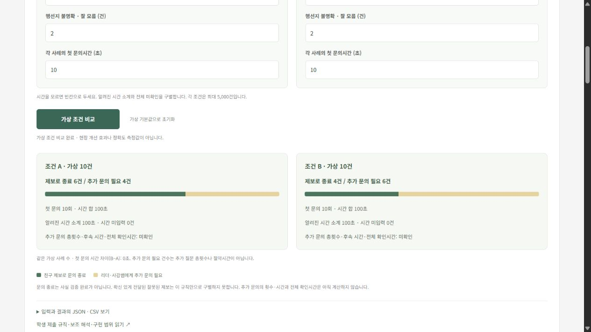

# 첫 문의 규칙의 가상 시나리오 비교

구현·검증일: 2026-11-02 (Asia/Seoul). [작업 #8](https://github.com/J0hns0n-K/FlowBench/issues/8).

## 이 기능이 답하는 질문

같은 첫 문의 규칙을 사용하더라도 **답변 유형의 구성**이 다르면 제보로 문의를 끝내는 사례와 추가 문의가 필요한 사례가 어떻게 달라지는지 비교합니다. 문의 사례는 익명 가상 단위이며 학교 전체 학생 수·실제 빈자리 수·학년별 질문 횟수와 동일하지 않습니다. 실제 사례를 입력하거나 현장 분포에 맞추어 보정한 기능이 아닙니다.

학생이 제출한 [문의 절차와 조건](ESCALATION_PROCEDURE_KO.md)을 보조 구현했습니다. 구체적인 행선지가 전달되고 불확실성 표시가 없으면 친구 제보에 근거해 문의를 끝냅니다. 불확실하면 추가 문의가 필요합니다. 이 상태가 실제 행선지·허가 여부를 검증하지는 않습니다.

## 집계 계약

[순수 집계·비교 모듈](../src/inquiry-scenarios.ts)은 각 조건에 익명 유형별 건수와 첫 문의 입력을 받습니다. 유형 수는 최대 50, 건수는 0 이상의 정수이고 각 조건 합은 5,000건 이하입니다. 유형 코드가 중복되거나 실제 보고 출처가 섞이면 거절합니다. 각 유형은 기존 판단 모듈을 그대로 사용합니다.

유형 i의 건수를 n_i, 가상 첫 문의시간을 t_i라고 하면:

- 첫 문의 횟수 = `sum(n_i)`. 사례당 첫 문의 1회라는 명시적 가정입니다.
- 제보로 종료 건수 + 추가 문의 필요 건수 = 전체 가상 사례 수.
- 알려진 시간 소계 = 시간이 주어진 유형의 `sum(n_i × t_i)`.
- 양수 건수인 유형에 시간 미입력이 있으면 첫 문의 전체 합은 **미확인**입니다.
- 0건인 유형의 시간 미입력은 실제 작업이 없으므로 전체 합을 미확인으로 만들지 않습니다.
- **추가 문의 총횟수·후속 문의시간·전체 출석 확인시간은 항상 미확인**으로 보존합니다. 초기 훑기·재확인·준비시간도 이 모듈에 포함하지 않습니다.

추가 문의 필요 4건은 추가 질문이 정확히 4번이라는 뜻이 아닙니다. 각 사례가 어느 단계까지 가고 몇 번 기다리거나 재문의할지는 정하지 않았습니다. 두 조건은 서로 다른 규칙이 아닌 같은 규칙의 다른 가상 상황입니다. 사례 수가 다르면 화면에 표시하며, 시간 차이를 효과나 절약시간으로 부르지 않습니다.

## 화면 기본 예제 — 보조자가 만든 가상 숫자

| 답변 유형 | 조건 A | 조건 B |
| --- | ---: | ---: |
| 구체적인 행선지, 불확실성 표시 없음 | 6건 | 4건 |
| 구체적인 행선지, 불확실성 표시 있음 | 2건 | 4건 |
| 불명확한 행선지, 불확실함 | 2건 | 2건 |
| 첫 문의 합계 | 10회 | 10회 |
| 제보로 문의 종료 | 6건 | 4건 |
| 추가 문의 필요 | 4건 | 6건 |
| 사례당 첫 문의시간 | 가상 10초 | 가상 10초 |
| 첫 문의시간 합 | 100초 | 100초 |

이 예제는 추가 문의 필요 건수가 달라도 첫 문의시간 합은 같을 수 있음을 보여줍니다. 10초는 현장 질문시간으로부터 추정한 값이 아닙니다. 후속 시간은 모르므로 전체 확인시간 순위도 정하지 않습니다.

## 화면과 결과 형식

[화면 연결 모듈](../src/inquiry-ui.ts)은 조건별 건수·시간을 입력받고 종료/후속 필요 비율 막대와 수치를 표시합니다. 시간을 빈칸으로 두면 미확인으로 계산합니다. 입력 변경 시 이전 결과와 결과 미리보기를 숨겨 오래된 수치가 남지 않게 했습니다.

JSON은 원시 입력, 가중 집계, 규칙 출처 3개, 판단·집계 모델 버전, 실행 시각, 소스 리비전, 가정과 한계를 보존합니다. CSV는 요약 행과 유형별 행을 포함하고 미확인은 `unknown`으로 명시합니다. 빈 조건도 요약 행으로 남기고 셀의 따옴표·줄바꿈·수식 시작 문자를 처리합니다. 브라우저에서는 JSON·CSV 내용을 미리 봅니다. 실제 파일 다운로드는 이번 검증에서 실행하지 않았습니다.

## 검증과 범위

- [새 테스트 5개](../tests/inquiry-scenarios.test.ts): 가중 집계·보존 관계, 양수/0건의 미확인 시간, 서로 다른 사례 수, 입력 소유권, 잘못된 출처·범위, JSON 재현·CSV 출처/미확인 보존.
- 전체 **55개 테스트 통과**, 형식 검사·브라우저 빌드 통과.
- 브라우저: 기본 예제, B 시간 빈칸, 입력 변경 시 기존 결과 무효화, 명시적 0초, 서로 다른 사례 수, 합계 범위 초과, 초기화, JSON·CSV 미리보기 확인.
- 휴대폰 390×844에서 두 조건이 한 열로 표시되며 페이지 가로 넘침 없음. 브라우저 오류 로그 없음.

[휴대폰 검증 화면](images/2026-11-02-inquiry-comparison-mobile.png). 화면 증거는 개발 중 소스 버전으로 찍었으며 현장 실측 결과가 아닙니다.

문의 순서·종료·후속 조건은 학생 제출 기여입니다. 집계 모델, 기본 예제, 화면, 내보내기와 테스트는 Codex 보조 구현입니다. 뒤 문의 단계의 종료 기준, 서로 다른 답변 처리, 실제 정확도와 시간 예측 검증은 여전히 남아 있습니다. 현장 관찰 회차는 이 합성 작업으로 늘어나지 않습니다.

## 다음 학생 작업 — 실행 전에 예상하기

기본값에서 **조건 B의 ‘구체적 행선지·잘 모름 표시 있음’을 4건에서 1건으로, ‘표시 없음’을 4건에서 7건으로** 바꾼다고 가정합니다. 전체 사례 수와 첫 문의시간은 유지합니다. 실행 전에 제보로 종료 건수·추가 문의 필요 건수·첫 문의시간 합을 본인의 계산으로 적고 화면과 비교하는 과제입니다. 새로운 실제 시간 측정은 필요하지 않습니다.

### 첫 제출과 보조 검토 — 2026-11-02

사용자는 **`4/1/25`**를 제출했습니다. 보조자는 이를 앞서 제시한 조건의 세 출력값으로 해석하여 [원문·과제·보조 기준값](../data/student-scenario-prediction-2026-11-02.json)을 보존했습니다. 그러나 2026-11-03 사용자가 **‘새로 짜라는 게 아니라 원래 있던걸 말하는 거였어?’**라고 질문하여, 새 조건 만들기와 기존 조건 계산 사이에 과제 해석의 혼동이 드러났습니다. [후속 맥락 기록](../data/student-scenario-context-clarification-2026-11-03.json)에 따라 초기의 계산 오답 해석은 철회합니다. 사용자가 의도한 조건은 아직 미확인이므로 산술 오류·학습 능력의 근거로 사용하지 않습니다.

| 항목 | 사용자 숫자 — 적용 조건 미확인 | 보조자가 제시한 10건 조건의 기준값 |
| --- | ---: | ---: |
| 제보로 문의 종료 | 4건 | 7건 |
| 추가 문의 필요 | 1건 | 1+2=3건 |
| 첫 문의시간 합 | 25초 | (7+1+2)×10=100초 |

보조자가 제시한 10건 조건에서 기준값은 산술 계산과 집계 모듈의 실행 결과가 일치했습니다. **그 조건이라면** 종료·후속 필요 건수의 합은 10건이고 첫 문의시간은 전체 10건에 적용됩니다. 이 비교를 사용자가 새로 생각한 조건의 오답 판정에 적용하지 않습니다. 반대로 새 가상 조건이나 실제 현장 기록이었다고 확정하지도 않습니다.

제출값·최초 보조 해석·후속 정정을 구별해 보존합니다. 계산 오류를 전제로 요구했던 계산식 설명 과제는 중단합니다. 학생이 수정·검증을 완료했다고 기록하지 않으며, 구체적인 새 조건을 설계했다고도 간주하지 않습니다. 현재 다음 작업은 실제 설명한 절차가 화면의 분기 규칙에 맞게 반영되었는지 검토하는 것입니다. 추가 실제 측정은 요청하지 않습니다.
