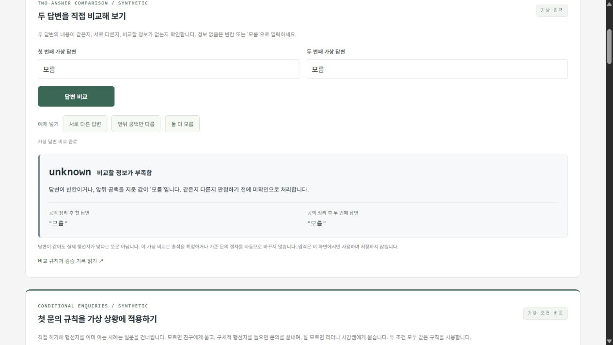
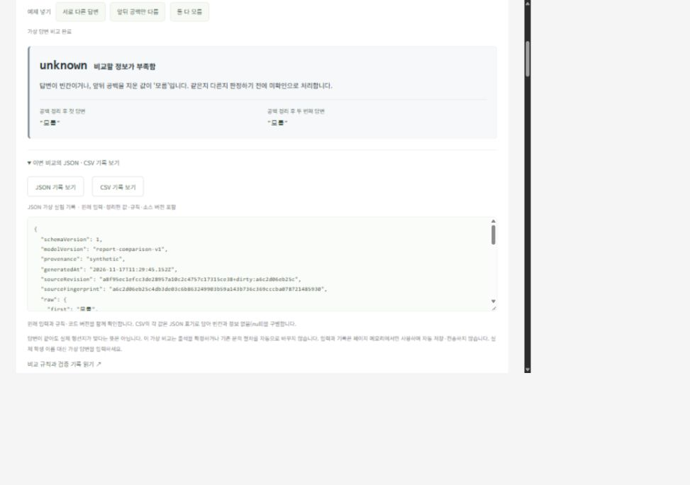
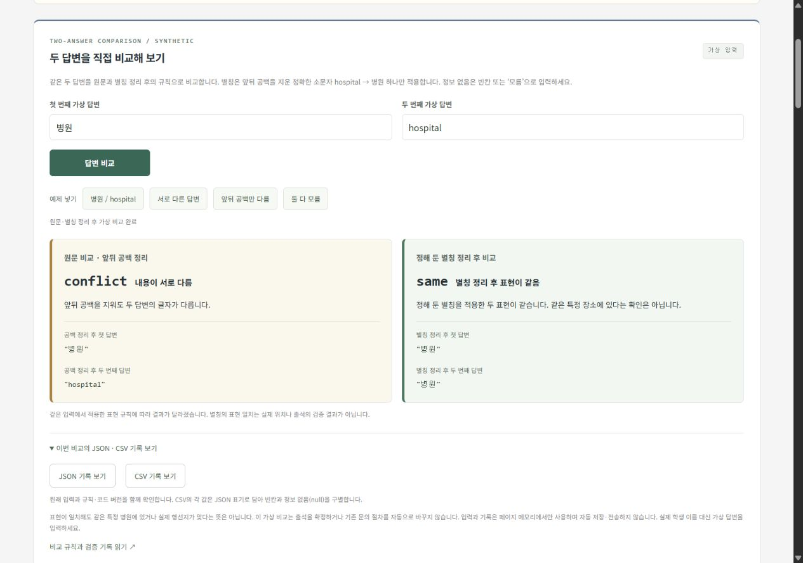

# 두 가상 답변 비교 화면

현재 화면·v2 기록 검증: 2026-11-18 (Asia/Seoul). [원문/별칭 비교 #12](https://github.com/J0hns0n-K/FlowBench/issues/12). 이전 구현: 2026-11-17. [화면 #10](https://github.com/J0hns0n-K/FlowBench/issues/10) · [재현 기록 #11](https://github.com/J0hns0n-K/FlowBench/issues/11).

## 연결한 기능

사용자가 안내에 따라 수정한 [compareDestinations](../src/report-consistency.ts)를 브라우저에서 직접 실행하는 화면입니다. [화면 모듈](../src/report-consistency-ui.ts)은 같은 함수를 호출하며 판단 규칙을 따로 복사하지 않습니다. 조건별 문의 횟수·시간 비교나 실제 출석 처리와는 독립된 가상 실험입니다.

| 가상 입력 | 결과 | 의미 |
| --- | --- | --- |
| 병원 / 반 | conflict | 정리한 두 문자열이 다름 |
| 앞뒤 공백이 있는 병원 / 병원 | same | 공백을 지운 문자열이 같음 |
| 모름 / 모름 | unknown | 같음 검사보다 정보 없음 검사가 우선 |
| 한쪽 빈칸 또는 공백뿐 | unknown | 비교할 정보가 부족함 |

첫 번째 예제는 [학생이 선택한 사례](../data/student-report-consistency-case-2026-11-16.json)입니다. 공백·양쪽 모름 예제와 화면 구성은 보조자가 만들었습니다. 학생의 [모름 조건 추가·순서 수정 과정](../data/student-unknown-marker-change-2026-11-17.json)과 화면 연결 작업을 구별합니다.

## 사용 방법과 범위

두 가상 답변을 입력한 뒤 ‘답변 비교’를 누르거나 Enter로 제출합니다. 네 예제 버튼은 두 입력값을 채우고 즉시 비교합니다. 기본값은 병원 / hospital입니다. 원문과 별칭 정리 후 두 카드에 코드·한국어 설명·각 규칙으로 정리한 값이 표시됩니다. 앞뒤 공백 정리 후 정확한 소문자 hospital → 병원 하나만 별칭으로 적용합니다. 입력을 바꾸면 이전 결과를 숨기고 다시 비교하도록 안내합니다.

입력은 각각 80자까지이며 필수 입력을 강제하지 않아 빈칸도 시험할 수 있습니다. 화면 입력은 문자열이고, `null` 분기는 기존 함수 단위 테스트에서 확인합니다. 정확한 ‘모름’ 표기와 빈칸만 정보 없음으로 처리하며 임의의 동의어나 표현을 이해하지 않습니다.

원문 카드의 same은 앞뒤 공백 정리 후 글자가 같다는 뜻이고, 별칭 카드의 same은 명시한 별칭 정리 후 표현이 같다는 뜻입니다. 병원 / hospital은 원문 conflict, 별칭 후 same입니다. 실제 위치나 허가 여부가 검증되었다는 뜻이 아닙니다. conflict/unknown도 실제 후속 문의나 출석 상태를 자동 변경하지 않습니다. 이 패널의 입력과 기록은 페이지 메모리에서만 사용하며 자동 저장·전송하지 않습니다. 기존 합성 시나리오 기록과 분리하며 출석 절차가 매번 두 답변을 요구한다고 가정하지 않습니다.

## 재현 가능한 비교 기록

‘이번 비교의 JSON · CSV 기록 보기’를 열고 형식을 선택합니다. [기록 모듈](../src/report-comparison-export.ts)은 원래 두 입력, 앞뒤 공백 정리 값, 기존 함수의 결과, 생성 시각, schemaVersion 2, modelVersion `report-comparison-v2`, 소스 Git revision·SHA-256 fingerprint를 담습니다. 판단 함수를 복사하지 않고 직접 호출합니다. 소스를 얻지 못한 경우는 `null`이며 확인된 버전으로 가장하지 않습니다. 생성 시각은 브라우저 시계의 기록 생성 시각으로 현장 관찰 시각이 아닙니다.

JSON은 `null`, 빈 문자열, 글자 그대로의 `unknown`, ‘모름’을 구별합니다. CSV는 헤더 22열과 결과 한 행으로, **각 셀의 내용 자체가 JSON 값**입니다. CSV 인용을 해제한 뒤 각 셀을 JSON으로 읽으면 원래 타입·공백·줄바꿈·쉼표·따옴표를 복원할 수 있습니다. 문자열 셀은 JSON 따옴표로 시작하여 수식처럼 생긴 입력도 문자로 담습니다. 일반 출석 명단용 CSV와는 다른 형식입니다.

두 형식은 같은 실행 기록을 사용합니다. 입력 변경은 결과·미리보기를 숨기고 내용을 지우며 형식 버튼을 비활성화합니다. 다시 비교하거나 예제를 선택하면 새 기록이 만들어집니다. 기록에는 가상 입력 표시, 규칙·출처 경로·해석 한계, 독립 검증 미확립을 포함합니다. 이 기능은 내용 미리보기이며 실제 파일 다운로드를 검증한 기능은 아닙니다.

## 검증 결과

아래 11/17 화면 검증은 당시 단일 결과 화면의 역사 기록입니다. 최신 두 결과 화면·v2 검증은 마지막 절에 따로 기록했습니다.

- 현재 전체 **69개 테스트와 형식 검사·브라우저 빌드 통과**. 기존 원문 판단 함수의 동작은 유지했습니다. 기록 테스트는 7개로, 기존 4개에 두 규칙의 경계 조건, v2 별칭표를 이용한 재실행, v2 CSV 보존 검증 3개를 추가했습니다.
- 브라우저에서 서로 다른 답변, 앞뒤 공백 차이, 양쪽 모름, 한쪽 빈칸, 공백을 감싼 모름을 확인했습니다.
- 입력 변경 시 이전 결과 숨김, 예제 재선택, Enter 제출, 정리한 값과 설명 표시를 확인했습니다.
- 390×844에서 입력과 결과가 한 열로 표시되고 문서 폭 375px로 가로 넘침이 없었습니다. 브라우저 오류 로그는 비어 있었고 임시 화면 크기는 복원했습니다.

[휴대폰 화면](images/2026-11-17-report-comparison-mobile.jpg). 개발 중 소스 기반의 검증 화면이며 새로운 현장 측정이 아닙니다. 실제 브라우저 파일 다운로드는 수행하지 않았습니다.

기본 함수는 보조 예제, 모름 조건 작성·피드백 후 재배치는 학생 작업, 요구사항·회귀 테스트·화면 구현·브라우저 검증은 Codex 보조 작업입니다. 화면 자체를 학생의 독립 구현 성과로 기록하지 않습니다.

### 기록 미리보기 추가 검증 — 2026-11-17

JSON에서 `  병원  ` / `병원`의 원래 공백, 정리한 값과 same, 양쪽 모름의 unknown, 한쪽 빈 문자열의 unknown을 확인했습니다. CSV에는 동일한 기록 시각·소스 fingerprint와 입력이 담겼습니다. 편집 시 미리보기 내용 삭제·버튼 비활성화, 예제 선택 시 이전 미리보기 숨김을 확인했습니다. 소스 미확인 `null`은 단위 테스트로 검증했으며 브라우저 장애 상황까지 재현하지 않았습니다.

데스크톱·휴대폰 크기 검증에서 요청한 viewport는 1280×900 및 390×844, DOM이 보고한 실제 CSS 폭은 984px 및 300px였습니다. 실제 문서 폭은 각각 973px 및 288px로 가로 넘침이 없었고, 좁은 화면 입력·결과는 한 열로 표시되었습니다. 미리보기 폭은 약 871px / 234px였습니다. 오류·경고 로그는 비어 있었고 임시 크기는 복원했습니다. 크기 복원 직후 첫 예제 선택이 반영되지 않아 새 상태를 읽고 다시 선택한 뒤 공백 예제 same을 확인했습니다.

[좁은 화면의 CSV 기록](images/2026-11-17-report-record-mobile.jpg). 개발 중 소스 revision과 dirty fingerprint를 기록한 검증 화면입니다. 기록 모듈·테스트·미리보기 구현과 검증은 Codex 보조 작업이며 학생의 직접 검토 완료는 아직 보고되지 않았습니다.

### 공백 정리 함수 공유 — 2026-11-18

사용자가 안내받은 함수 틀과 `return value.trim();`을 입력·저장한 것을 확인했습니다. 독립 설계나 코드 고안으로 기록하지 않습니다. Codex가 `trimDestination`을 비교 판단과 기록 생성에 연결하고, 화면은 기록의 normalized 값을 그대로 표시하도록 바꿨습니다. 원래 입력을 담은 raw는 보존하며 비교 규칙·JSON/CSV 형식·버전은 유지했습니다.

저장된 함수 직접 실행에서 null → null, 앞뒤 공백이 있는 병원 → 병원, 공백뿐인 문자열 → 빈 문자열, 공백이 있는 모름 → 모름, 학교 카페 → 학교 카페를 확인했습니다. 전체 기존 66개 테스트와 형식 검사·빌드가 통과했습니다. 기존 테스트가 공백·모름 우선순위와 raw/normalized 보존을 다루므로 중복 테스트는 추가하지 않았습니다. 이번 변경은 화면 구성 변경이 없어 브라우저 검증을 다시 수행하지 않았으며 위 스크린샷은 11/17 검증 당시 자료입니다.

### 별도 표현 정리 함수 — 2026-11-18 (화면 연결 전 기록)

사용자의 구현 요청에 따라 Codex가 normalizeDestinationLabel을 완성했습니다. trimDestination을 거친 정확한 hospital만 병원으로 바꾸며 대소문자를 일반화하거나 임의 번역을 추론하지 않습니다. 이 함수는 compareDestinations·화면·기록 생성에 연결되지 않았으므로 기존 병원 / hospital 비교 결과는 여전히 conflict입니다. 앞선 버전의 원문 비교 규칙과 내보내기 계약을 변경하지 않았습니다.

직접 실행으로 hospital, 공백이 있는 hospital, 병원, null, 공백뿐인 입력, 공백이 있는 모름, Hospital, 학교 카페의 8개 사례를 확인했고 재적용해도 값이 유지됐습니다. 기존 비교 결과도 별도로 확인했습니다. 전체 기존 66개 테스트와 형식 검사·빌드가 통과했습니다. 단순 조건 함수는 직접 점검했으며 영구 테스트나 브라우저 검증은 추가하지 않았습니다. 이 작업은 보조자 구현으로 기록하며 같은 물리적 병원이나 출석을 검증하는 기능이 아닙니다.

### 원문·별칭 두 규칙과 v2 기록 — 2026-11-18

앞선 별도 함수 미연결 상태를 확장해 두 결과를 함께 표시했습니다. 기존 compareDestinations와 루트 result는 원문 비교를 유지합니다. aliasComparison은 hospital-label-v1, 별칭표 [{from: hospital, to: 병원}], 별칭 정리한 값·결과·규칙을 담습니다. 표와 함수는 같은 frozen 별칭 상수를 사용하며 각 기록은 표 사본을 보유합니다. 실제 문의·출석 상태는 변경하지 않습니다.

| 가상 입력 | 원문 | 별칭 후 | 경계 |
| --- | --- | --- | --- |
| 병원 / hospital | conflict | same | 사용자가 선택한 번역 표현 사례 |
| 병원 / 공백이 있는 hospital | conflict | same | 원래 공백은 raw에 보존 |
| 병원 / Hospital | conflict | conflict | 대소문자 자동 변환 없음 |
| 학교 카페 / 학교카페 | conflict | conflict | 가운데 공백 제거 없음 |
| 병원A / 병원B | conflict | conflict | 장소명 뭉개기 없음 |
| 모름 / 모름 또는 한쪽 정보 없음 | unknown | unknown | 같음보다 정보 없음이 우선 |

JSON의 raw/normalized/result는 원래 입력·앞뒤 공백 정리 값·원문 결과입니다. aliasComparison.normalized/result는 별칭을 적용한 값·결과입니다. 루트 schema/model을 v2로 올려 v1 기록과 구별합니다. CSV는 기존 16열에 alias_model_version, alias_table, first_alias_normalized, second_alias_normalized, alias_result, alias_rules를 더한 22열이며 모든 셀은 JSON 값 표기를 유지합니다. 원문·별칭 결과와 별칭표가 함께 있어 기록의 입력으로 두 계산을 다시 실행할 수 있습니다. v1 파일을 읽는 가져오기 기능은 없습니다.

새 테스트 3개로 두 결과·unknown 우선순위·정확한 별칭 범위, 저장된 표로 JSON 재실행, CSV의 두 정리 값과 null 메타데이터 보존을 확인했습니다. 전체 69개 테스트와 빌드가 통과했습니다. 브라우저에서는 기본 사례, 공백 감싼 hospital, Hospital, 빈칸, 양쪽 모름, 기존 예제, Enter 제출, 편집 시 두 결과·기록 숨김과 내용 삭제, 형식 버튼 비활성화, 예제 선택 시 이전 기록 숨김을 확인했습니다. JSON schema 2와 별칭표/두 결과, CSV 22열도 확인했습니다.

1280×900에서는 두 카드가 나란히 표시되고 문서 폭은 1265px였습니다. 390×844에서는 한 열로 표시되고 문서 폭 375px, 카드·미리보기 폭 약 313.6px로 가로 넘침이 없었습니다. 오류·경고 로그가 비어 있었으며 임시 크기는 복원했습니다. 실제 파일 다운로드는 수행하지 않았습니다.

[휴대폰 화면](images/2026-11-18-alias-comparison-mobile.jpg). 개발 중 소스와 dirty fingerprint를 담은 검증 화면입니다. 별칭 사례는 학생 선택, 정리 규칙의 구현·상수 공유·두 결과 화면·버전 변경·테스트·QA는 Codex 보조 작업입니다. 학생의 독립 구현이나 직접 사용성 검증, 같은 특정 병원의 확인으로 기록하지 않습니다.

### 표현 일치와 실제 장소의 식별 한계 — 2026-11-18

[실행 가능한 반례](LABEL_COMPARISON_LIMITS_KO.md)는 병원 / hospital과 병원 / 병원 각각에 같은 장소·다른 장소인 가상 상황을 구성합니다. 숨은 장소 식별자는 평가용 설정으로만 사용합니다. 함수가 받는 문자열이 같으면 두 상황에서 완전한 비교 기록도 같으므로 실제 장소의 일치를 식별할 수 없습니다. 이 점검은 현재 화면·표현 규칙을 변경하지 않습니다. 사후 구성한 반례이며 새로운 현장 측정·정확도 추정이 아닙니다.
