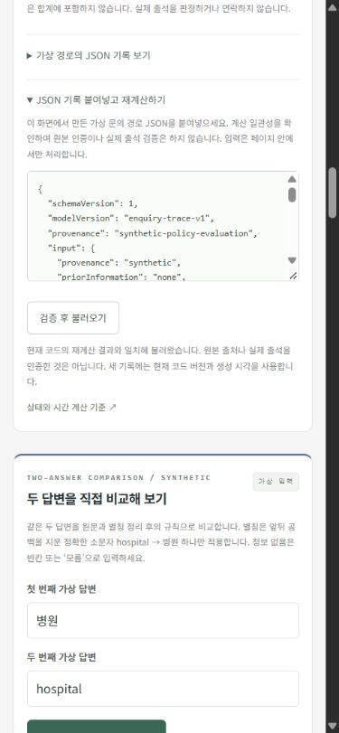

# 재현 흐름 점검 — 2026-11-18

## 이번에 확인한 흐름

휴대폰 크기 390×844에서 가상 예제 ‘시간 하나 미확인’을 실행하고 JSON을 생성한 뒤 붙여넣어 재계산·불러오기를 수행했습니다. 전체 문의시간 null과 알려진 소계 17초가 유지됐습니다. 첫 문의를 10초에서 12초로 편집한 뒤 재계산하면 소계가 19초가 되며 전체 시간은 여전히 null입니다. 이 숫자들은 합성 예제이며 현장 재측정값이 아닙니다.

점검 중 편집 뒤에도 이전 재계산 일치 안내가 남는 것을 발견했습니다. 결과를 무효화할 때 해당 안내도 지우도록 수정했고, 편집 시 결과 숨김·안내 초기화, 다시 불러올 때 새 안내 표시를 확인했습니다. 계산 규칙은 변경하지 않았습니다.

화면 폭 390px에서 문서 폭375px, JSON 입력 폭 약313.6px로 가로 넘침이 없었습니다. 오류·경고 로그는 비어 있었고 임시 크기를 복원했습니다. 앞선 데스크톱 전용 재계산 검증에 이번 휴대폰 확인을 추가한 것입니다.



## 재현 명령

Node.js 24 이상과 설치된 잠금 의존성이 있는 환경에서 아래 명령을 사용합니다. pnpm 명령은 README의 설치 절차를 참고합니다.

```text
node --run test
node scripts/build.mjs
node scripts/label-comparison-limits.mjs
node scripts/project-overview.mjs --check
node scripts/serve.mjs
```

첫 네 명령은 각각 기존 자동 검증, 형식 검사·브라우저 빌드, 표현/장소 식별 한계 반례 재현, 개요 최신성 검사를 수행합니다. 마지막 명령은 로컬 화면을 엽니다. 개발 중 화면 증거는 생성 당시 소스와 fingerprint를 가리키며 최종 커밋의 새 화면 검증으로 소급하지 않습니다.

## 완료 범위와 남은 검증

| 범위 | 현재 상태 |
| --- | --- |
| 첫 문의 정책·합성 시나리오·단계별 기록 | 구현·단위 검증됨. 실제 학교 정책 승인과 구별 |
| 표현 비교와 명시 별칭 | 원문/별칭 결과를 구별하며 실제 장소를 확정하지 않음 |
| 단계별 JSON 재계산·다시 편집 | 데스크톱 및 이번 휴대폰 흐름 확인. 계산 일관성 검사 |
| 학생의 실제 기여 | 절차·수행 보고·사례 선택·안내에 따른 코드 입력을 별도 장부에 기록 |
| 독립 정확도·다른 담당자 업무량 | 미확인. 합성 테스트 통과로 대체하지 않음 |
| 후속 문의의 종료 기준·대상 순서 승인 | 미확인. 입력한 판단 기록과 경로를 보존할 뿐 자동 승인하지 않음 |
| 실제 브라우저 파일 다운로드 완료 | 미검증. 이번 점검에서 시도하지 않음 |
| 원본 출처 인증 | 제공하지 않음. 입력과 결과를 함께 일관되게 바꾼 JSON은 계산 검사를 통과할 수 있음 |

이번 점검·수정·문서는 Codex 보조 작업입니다. GitHub 작성자 계정 설정과 실제 기여의 구분을 유지하며, 학생의 직접 사용성 검토나 새로운 현장 관찰을 추가한 것으로 기록하지 않습니다.

## 고정 문의 실험 실행기 — 2026-11-20

[가상 입력](../data/enquiry-trace-fixtures-v1.json)과 [실행기](../scripts/enquiry-trace-fixtures.mjs)를 추가했습니다. 시작 전, 사전 정보 생략, 첫 친구 종료, 후속 문의 필요, 후속 판단 미기록, 후속 종료 기록, 시간 미확인, 명시적0초의 8개 사례입니다. 모두 구현 후 보조자가 구성한 고정 예제이며 현장 자료·사전등록·독립 평가 표본이 아닙니다.

실행은 아래 한 명령으로 저장 기록을 다시 확인합니다. 정상 검사에서는 파일을 덮어쓰지 않습니다.

```text
node --run trace:fixtures
```

예상 상태·종료 표시·시간 합·알려진 소계·미확인 수를 확인하고, 각 JSON을 재계산하며 CSV34열·행 수·문의별 시간/오프셋/상태와 요약 입력 재실행을 대조합니다. [저장 결과 묶음](../experiments/2026-11-20-enquiry-traces-v1.json)은 각 사례의 전체 JSON 기록과 CSV 문자열, 명시한7개 소스 파일의 LF 정규화 SHA-256 fingerprint, 생성 시각·Git revision을 담습니다. CSV는 이 묶음 안에 문자열로 보존하며 브라우저 파일 다운로드 완료를 검증하는 절차가 아닙니다.

기본 검사는 현재 소스 fingerprint가 같아야 하며 저장 당시 메타데이터로 결과를 다시 생성해 묶음 전체를 비교합니다. 검사 요약은 실행 시점의 revision도 표시합니다. 생성 시각·revision 문법을 검사하지만 출처를 인증하지 않습니다. 고정 기록을 검토 후 갱신하려면 `node scripts/enquiry-trace-fixtures.mjs --write`를 명시적으로 실행합니다. 초기 결과의 dirty revision은 구현 중 소스이며 fingerprint로 코드 내용을 식별합니다.

CSV 한 곳을 의도적으로 잘못 바꾸자 검사가 실패했고 원본 복원 후8개 모두 통과했습니다. 기존83개 단위 테스트와 형식 검사·빌드도 통과했습니다. CI는 단위 테스트와 별도로 같은 고정 실험 검사를 실행합니다. 전체 정확도·평균 개선율·현장 오류율은 산출하지 않으며 empiricalAccuracy는 null입니다. 후속 종료 기준·경로의 타당성은 미확립으로 유지합니다.

실행기·입력 구성·저장 묶음·검증·CI 연결은 Codex 보조 작업입니다. 새 학생 독립 구현·새 현장 관찰·학생 사용성 검증을 추가하지 않습니다. 화면 변경이 없어 브라우저 QA는 다시 하지 않았습니다.

## 한 명령 검증 — 2026-11-20

의존성이 설치된 Node24+ 환경에서 `node --run verify` 또는 `pnpm verify`를 실행합니다. [실행기](../scripts/verify.mjs)는 단위 테스트→개요 최신성→형식 검사/빌드→표현/장소 반례→저장된 문의 JSON/CSV의5단계를 순서대로 수행합니다. 첫 실패에서 중단하고 실패 종료코드를 반환합니다. 스크립트 위치를 기준으로 저장소를 찾으며 운영체제 셸에 문자열 명령을 넘기지 않습니다.

이 명령은 저장된 실험 결과를 다시 쓰지 않습니다. 빌드 출력은 기존 dist에 생성합니다. 결과 갱신용 --write는 해당 실행기에서 명시적으로 수행해야 하며 이 통합 명령은 받지 않습니다. 기존 `pnpm experiment`는 합성 민감도 결과를 재생성하므로 통합 읽기 검증과 분리했습니다. CI는 `pnpm verify` 후 별도 민감도 재생성을 계속 실행합니다. 검증 통과는 현장 정확성·출처 인증·학생 독립 구현을 입증하지 않습니다. 실행기/CI/문서는 보조 작업입니다.

실행 검증에서는 기존83개 단위 테스트, 문서 최신성, 형식 검사·빌드, 표현/장소 반례2쌍, 문의 고정 사례8개가 모두 통과했습니다. README의 최신성 fingerprint를 의도적으로 어긋나게 하자2단계에서 실패했고3~5단계는 실행되지 않았습니다. 원본을 복원한 뒤 최신성 검사는 다시 통과했습니다. experiments의 추적 파일에 변경이 없다는 점도 확인했습니다. 화면을 변경하지 않아 브라우저 점검은 다시 하지 않았습니다.
